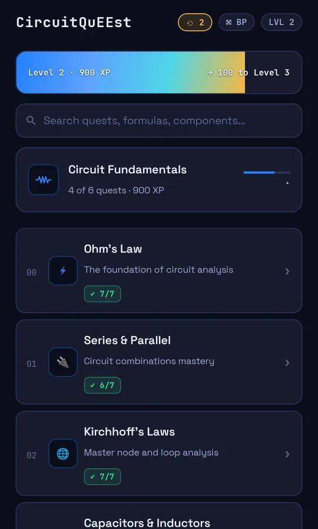
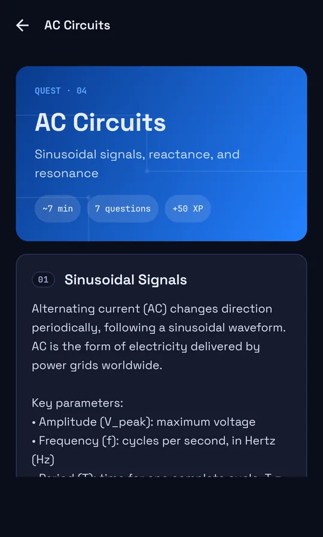
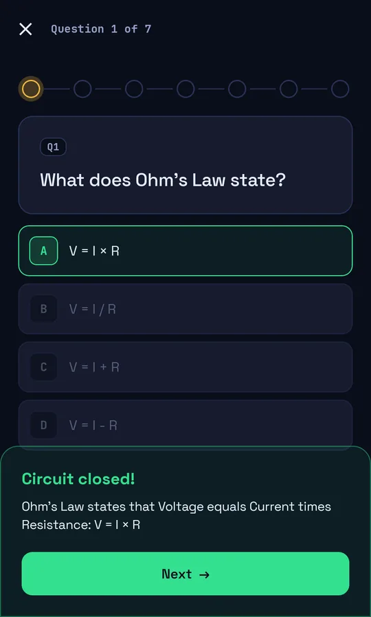
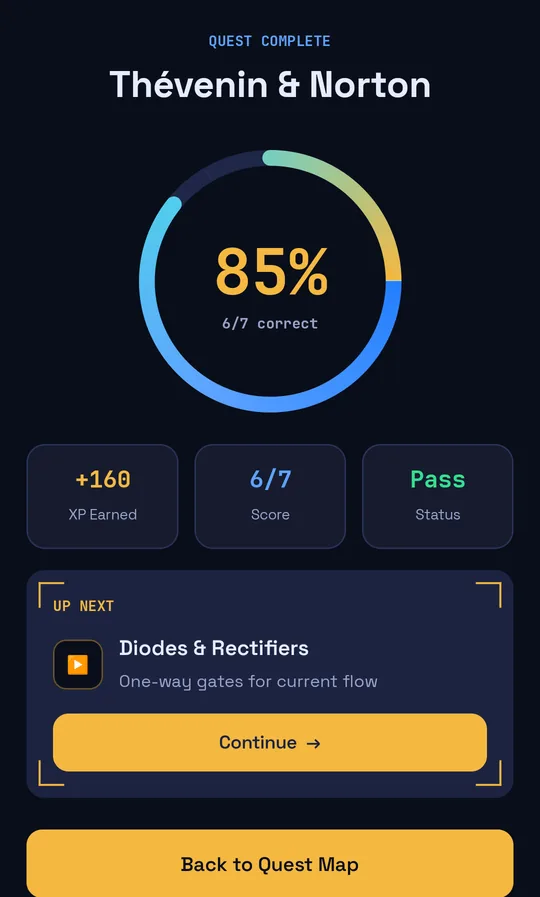
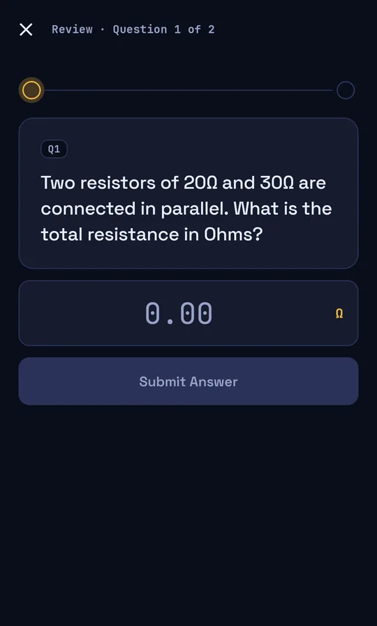
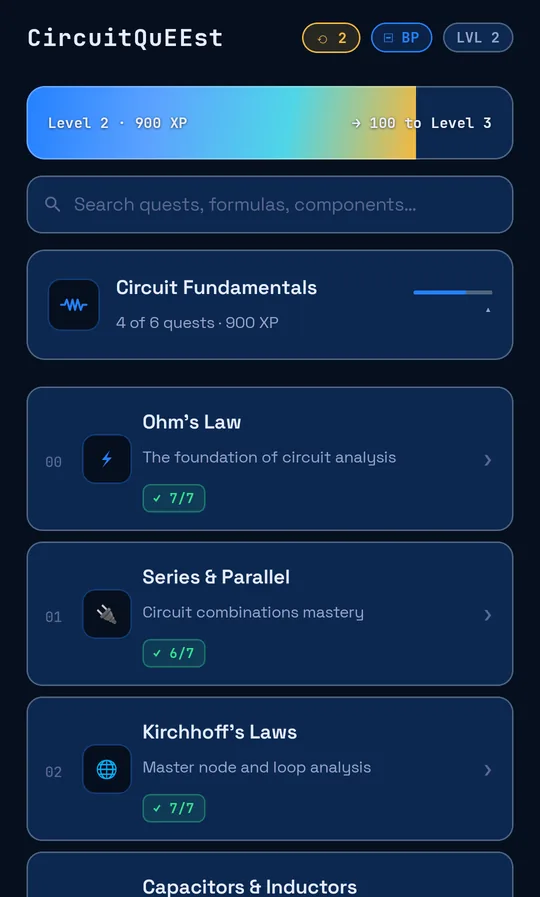

<div align="center">

# ⚡ CircuitQuEEst

**Master Electrical Engineering through gamified quests**

[](https://github.com/HighviewOne/CircuitQueest/actions/workflows/build.yml)
[](https://github.com/HighviewOne/CircuitQueest/releases)
[](https://developer.android.com)
[](https://kotlinlang.org)
[](https://developer.android.com/jetpack/compose)
[](LICENSE)

[**Website**](https://circuitquest.mirarver.com/) · [**Documentation**](https://circuitquest.mirarver.com/documentation.html) · [**Privacy**](https://circuitquest.mirarver.com/privacy.html)

</div>

---

CircuitQuEEst is an offline-first Android app that teaches electrical engineering through a quest-based progression system. Work through 42 topics — from Ohm's Law to ML Hardware — each with a structured lesson and a 7-question quiz. Earn XP, unlock new topics, and track your progress entirely on-device.

> **Theme:** Cockpit dark aesthetic — Space Grotesk + JetBrains Mono, electric blue/gold palette, PCB trace motifs, IEEE schematic icons, and a toggleable blueprint mode.

## Screenshots

| Quest map | Lesson | Quiz feedback | Result | Review mode | Blueprint mode |
|:---:|:---:|:---:|:---:|:---:|:---:|
|  |  |  |  |  |  |
| Categories · search · XP bar | PCB hero · formulas | Instant explanation | Score ring · up-next | Replays missed questions | Alternate palette |

## Features

- **42 EE topics** spanning fundamentals through advanced — Ohm's Law, Kirchhoff, MOSFETs, VLSI, RF, ML Hardware, and more
- **Quest progression** — pass a topic's quiz (60%+) to unlock the next, in the order shown on the quest map; no internet required
- **XP system** — +50 XP per lesson, 10 XP per point above your best quiz score, +100 bonus on your first pass
- **Dual question types** — multiple choice and numeric input with tolerance-aware grading
- **Review mode** — every missed question goes into a review queue (⟲ chip on the quest map, "Review mistakes" after a quiz); replay until you get them right
- **Study streaks** — days in a row with a lesson, quiz or review, plus your best run, shown under the XP bar (no XP bonus)
- **Blueprint mode** — toggleable alternate palette (deep navy + white-28% borders)
- **Shared-element transitions** — topic cards morph into the lesson hero
- **Offline-first** — all content and progress in a local Room database; no account needed
- **Cockpit UI** — bundled Space Grotesk + JetBrains Mono, shimmer XP bar, pulsing progress nodes

## Topic Curriculum

<details>
<summary>All 42 topics across 9 categories, in unlock order (quest numbers as shown in the app)</summary>

| # | Topic | Category |
|---|-------|----------|
| 00 | Ohm's Law | Circuit Fundamentals |
| 01 | Series & Parallel | Circuit Fundamentals |
| 02 | Kirchhoff's Laws | Circuit Fundamentals |
| 03 | Capacitors & Inductors | Circuit Fundamentals |
| 04 | AC Circuits | Circuit Fundamentals |
| 05 | Thévenin & Norton | Circuit Fundamentals |
| 06 | Diodes & Rectifiers | Semiconductor Devices |
| 07 | Transistors (BJTs) | Semiconductor Devices |
| 08 | MOSFETs | Semiconductor Devices |
| 09 | Semiconductor Physics | Semiconductor Devices |
| 10 | Op-Amps | Analog Design |
| 11 | Filters | Analog Design |
| 12 | Analog Circuit Design | Analog Design |
| 13 | Audio Electronics | Analog Design |
| 14 | Digital Logic Gates | Digital Systems |
| 15 | Digital Systems | Digital Systems |
| 16 | VLSI Design | Digital Systems |
| 17 | Machine Learning Hardware | Digital Systems |
| 18 | Signals & Systems | Signals & Control |
| 19 | Control Systems | Signals & Control |
| 20 | Digital Signal Processing | Signals & Control |
| 21 | Transformers | Power & Energy |
| 22 | Power Electronics | Power & Energy |
| 23 | Power Systems | Power & Energy |
| 24 | Renewable Energy | Power & Energy |
| 25 | Electric Vehicles | Power & Energy |
| 26 | Battery & Energy Storage | Power & Energy |
| 27 | Electromagnetics | RF & Communications |
| 28 | Transmission Lines | RF & Communications |
| 29 | Communication Systems | RF & Communications |
| 30 | Antenna Design | RF & Communications |
| 31 | RF Circuit Design | RF & Communications |
| 32 | Fiber Optics & Photonics | RF & Communications |
| 33 | Radar Systems | RF & Communications |
| 34 | PCB Design | Hardware & Embedded |
| 35 | Embedded Systems | Hardware & Embedded |
| 36 | Sensors & Measurement | Hardware & Embedded |
| 37 | Signal Integrity & EMC | Hardware & Embedded |
| 38 | IoT & Wireless | Hardware & Embedded |
| 39 | Electric Machines | Specialized Applications |
| 40 | MEMS | Specialized Applications |
| 41 | Biomedical Electronics | Specialized Applications |

</details>

## Tech Stack

| Layer | Technology |
|-------|-----------|
| Language | Kotlin 2.0.21 |
| UI | Jetpack Compose (BOM 2024.12.01) |
| Architecture | MVVM · Hilt DI · Room |
| Navigation | Navigation Compose with shared-element transitions |
| Storage | Room 2.6.1 (offline-first, no backend) |
| Fonts | Space Grotesk + JetBrains Mono (bundled, fully offline) |
| Min SDK | 26 (Android 8.0) · Target SDK 36 (Android 16) |
| Build | Gradle 8.13 · AGP 8.13.2 · KSP |

## Quick Start

**Prerequisites:** JDK 17, Android SDK (platform 36, build-tools 36)

```bash
git clone https://github.com/HighviewOne/CircuitQueest.git
cd CircuitQueest
./gradlew assembleDebug
# APK → app/build/outputs/apk/debug/app-debug.apk  (~12 MB)
```

**Other tasks:**

```bash
./gradlew detekt          # Static analysis
./gradlew test            # Unit tests
./gradlew clean           # Clear build output
```

## Architecture

```
HomeScreen / LessonScreen / QuizScreen / ResultScreen
        ↓ (Hilt ViewModels)
HomeViewModel · LessonViewModel · QuizViewModel
        ↓ (StateFlow)
ProgressRepository
        ↓ (Room DAOs)
TopicProgress · QuizResult  (SQLite, local only)
```

Content is stored as Kotlin singleton objects in `data/content/` — no JSON, no API. Navigation uses `SharedTransitionLayout` for hero morphing between the topic list and the lesson screen.

## Adding a Topic

1. Create `app/src/main/java/com/circuitqueest/app/data/content/YourTopicContent.kt` — a singleton `object` with a `Topic`, 6+ `LessonSection`s, and a 7-question `Quiz`.
2. Add it to `TopicsService.allTopics`.
3. Add its id to a category in `TopicCategories`. The categories, top to bottom, define the unlock order, and each topic's `order` must equal its position in that list (a unit test checks this).
4. Done — unlock and XP handling are automatic.

See any existing `*Content.kt` file for the exact shape.

## Contributing

Bug reports and content corrections are welcome. Please use the [issue templates](.github/ISSUE_TEMPLATE/) — there are forms for bugs, feature requests, and documentation improvements.

For code changes, open a PR against `master`. The build CI must pass.

## License

[MIT](LICENSE) © 2026 CircuitQuEEst
